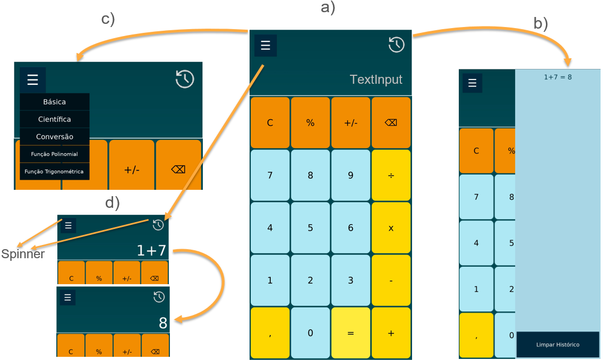
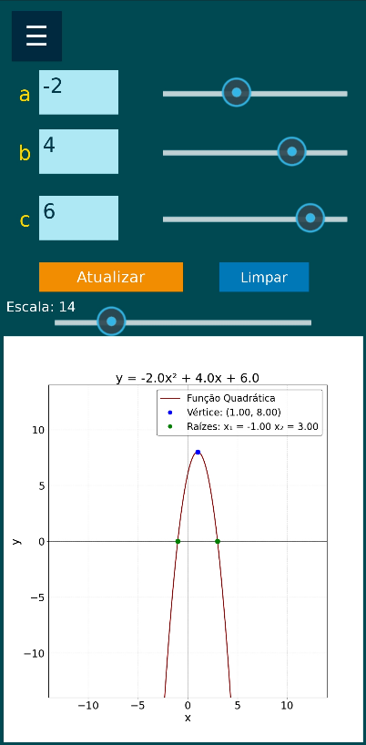
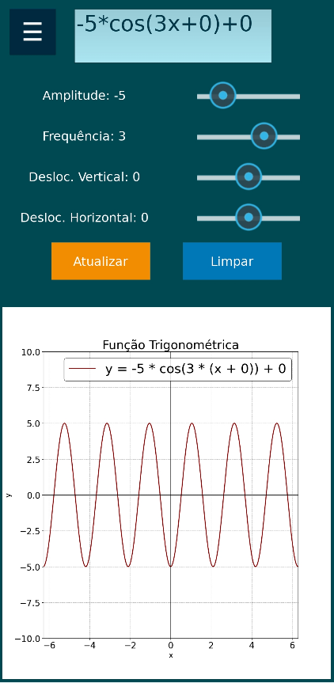

O CAMGPOL Mobile é um aplicativo educacional desenvolvido para apoiar o ensino e a aprendizagem da Matemática por meio de recursos digitais interativos e de fácil utilização. O aplicativo reúne funcionalidades de calculadora, conversão de medidas e exploração gráfica de funções polinomiais e trigonométricas, oferecendo um ambiente acessível para estudantes e professores.

Seu principal diferencial está na possibilidade de explorar visualmente o comportamento das funções matemáticas, especialmente das funções quadráticas. Por meio da inserção de coeficientes e de controles deslizantes interativos, o usuário pode modificar os parâmetros da função e observar, em tempo real, as transformações no gráfico da parábola.

O módulo de funções quadráticas permite investigar conceitos fundamentais, como concavidade, vértice, raízes, discriminante (Δ), pontos de máximo e mínimo, além da influência dos coeficientes 
a, b e c sobre a representação gráfica.

Desenvolvido com foco na simplicidade, usabilidade e aprendizagem móvel (Mobile Learning), o CAMGPOL Mobile busca aproximar os conceitos matemáticos da experimentação prática, favorecendo a visualização, a construção do conhecimento e a autonomia dos estudantes.

**Principais objetivos:**

Apoiar o ensino e a aprendizagem da Matemática.
Facilitar a visualização e a interpretação de funções matemáticas.
Permitir a manipulação dinâmica dos coeficientes das funções quadráticas.
Estimular a experimentação e a autonomia na aprendizagem.
Oferecer uma ferramenta digital de apoio às práticas pedagógicas.
O CAMGPOL Mobile foi concebido como um recurso de apoio educacional, podendo ser utilizado tanto em atividades escolares quanto em estudos individuais.

**Registro de programa de computador:** BR512025002615-3.

Para dúvidas ou contribuições, entre em contato:
Jailson França dos Santos – jailson.santos@ufob.edu.br

  

  
  

